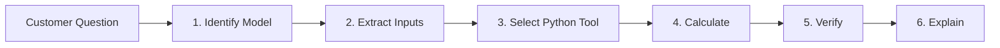

# Supply Chain Analytics: Inventory Decision Agent

An autonomous decision-support system that processes natural language inventory questions, identifies the underlying supply chain model, extracts parameters, executes numerical calculations, verifies optimality conditions, and provides executive recommendations.

---

## 🏛️ Decision Pipeline Architecture



1. **Customer Question**: User submits a business inquiry in natural language.
2. **Identify Model**: Classifies the query into one of the 5 core inventory models.
3. **Extract Inputs**: Extracts and normalizes numerical inputs, units, and price breaks.
4. **Select Python Tool**: Dispatches to the corresponding function in `inventory_tools.py`.
5. **Calculate**: Executes pure Python analytical calculations with high precision.
6. **Verify**: Tests mathematical conditions (convexity, derivative conditions, bracket constraints).
7. **Explain**: Generates an executive decision summary, calculation breakdown, and strategic insights.

---

## 📦 Supported Decision Models

1. **Economic Order Quantity (EOQ)**
   - Balances annual ordering/setup cost and unit inventory carrying cost.
   - Computes $EOQ = \sqrt{\frac{2DS}{H}}$, annual order frequency $N = D / Q^*$, order cycle time $T = \text{Operating Days} / N$ (extracts custom operating days from question or applies explicitly documented default of 250 working days/year), annual ordering and holding costs, and sensitivity ($\pm 10\%$).
2. **Quantity Discount Optimization**
   - Evaluates all-unit price break schedules across discrete brackets.
   - Identifies unconstrained EOQs, tests bracket feasibility, clamps to lower price breaks when appropriate, and finds global minimum total annual cost.
3. **Safety Stock & Reorder Point (ROP)**
   - Continuous review $(s, Q)$ system under stochastic demand and replenishment lead time.
   - Supports: variable demand + constant lead time, constant demand + variable lead time, and both variable.
   - Computes $SS = z \cdot \sigma_L$, $ROP = d \cdot L + SS$, and cycle stockout probabilities.
4. **Fixed-Period Review Model (Periodic Review / Order-Up-To)**
   - Periodic review system $(T, S)$ over protection interval $(T + L)$.
   - Computes target base stock $M = d(T + L) + z \sigma_d \sqrt{T + L}$ and net replenishment quantity $Q = \max(0, M - IP)$.
5. **Newsvendor Model (Single-Period Stochastic Demand)**
   - Single-period seasonal or perishable inventory with salvage value.
   - Computes marginal underage ($C_u$) and overage ($C_o$) costs, critical fractile $CR = \frac{C_u}{C_u + C_o}$, optimal quantity $Q^*$, expected sales, expected leftovers, and expected profit.
6. **Multicriteria Inventory Classification (BAN517 Course Methodology)**
   - Evaluates inventory items across both revenue volume (Sales, 65% weight) and operational velocity (POS Hits, 35% weight).
   - Computes independent Pareto ABCD cutoffs: Class A (0% through 60%), Class B (above 60% through 80%), Class C (above 80% through 90%), and Class D (above 90% through 100%).
   - Maps individual class scores ($A=4, B=3, C=2, D=1$), calculates combined weighted scores: $\text{Combined Weighted Score} = (0.65 \times \text{Sales Score}) + (0.35 \times \text{POS Hits Score})$.
   - Assigns final managerial classifications based on exact course score thresholds: Final A ($3.25 \le \text{Score} \le 4.00$), Final B ($2.50 \le \text{Score} < 3.25$), Final C ($1.75 \le \text{Score} < 2.50$), and Final D ($\text{Score} < 1.75$).
   - Provides executive summary metrics, detailed summary tables of item counts and total sales by final classification tier, visual comparison charts, and CSV data export.


---

## 🚀 Quick Start Guide

### 1. Setup Virtual Environment & Install Dependencies

```bash
# Create and activate virtual environment
python3 -m venv .venv
source .venv/bin/activate

# Install dependencies
pip install -r requirements.txt
```

### 2. Interactive Terminal CLI (REPL)

```bash
python app.py
```

### 3. Run Benchmark Suite Across All 5 Models

```bash
python app.py --demo
```

### 4. Run Single Query via Command Line

```bash
python app.py --query "We sell 10,000 units per year. Each order costs $50, and our holding cost is $2 per unit per year. What is our optimal order quantity?"
```

### 5. Launch Interactive Web Dashboard (Streamlit)

```bash
streamlit run app.py
# or
python app.py --web
```

---

## 🧪 Running the Test Suite

```bash
pytest tests/test_inventory_tools.py -v
```
All 61 test cases cover numerical formulas against textbook analytical benchmarks, edge cases, error validation, end-to-end agent query flows, CSV data analysis, and multicriteria inventory classification.

